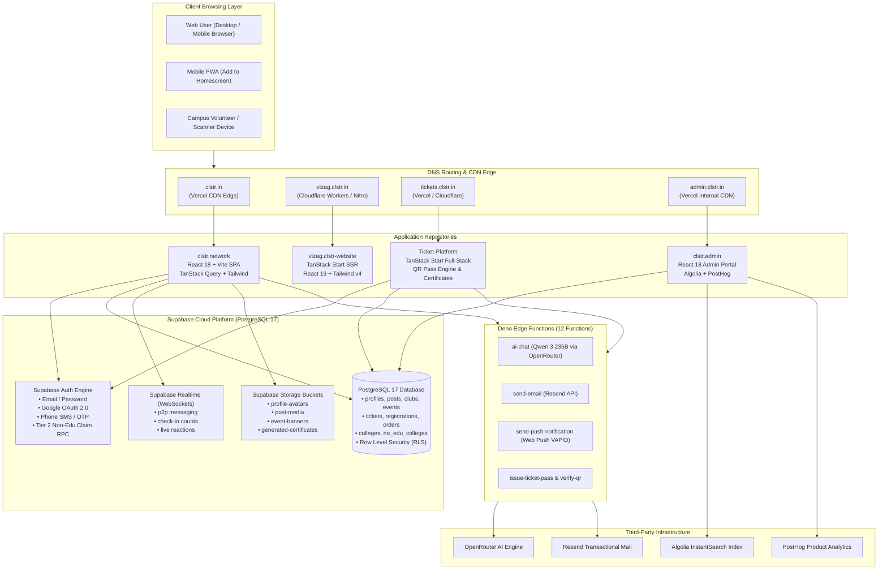
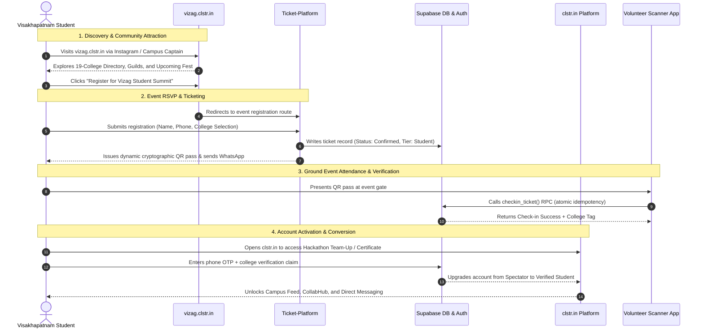

# 01 — Master System Architecture

> **Complete system architecture, service topology, data flow, and deployment model across the Clstr ecosystem.**

---

## 1. System Vision & The Three-Layer Paradigm

Higher education in India suffers from severe campus isolation. While Tier 1 elite institutions (IITs, IIMs, BITS) have institutional email domains (`@iitd.ac.in`) and established alumni networks, the vast majority of Indian engineering, arts, science, and polytechnic colleges (Tier 2 and Tier 3) do not issue individual student email accounts. Students are fragmented across disconnected WhatsApp groups that expire upon graduation.

The **Clstr Ecosystem** is engineered as a three-layer flywheel:

1. **Layer 1: The Core Platform (`clstr.in`)**  
   The high-trust digital campus. Handles student identity verification (Tier 1 .edu and Tier 2 non-edu OTP), college-scoped feeds, cross-campus collaboration (CollabHub), direct peer messaging, digital portfolio building, student marketplace (EcoCampus), mentorship, and AI career guidance.
2. **Layer 2: The Beachhead Community (`vizag.clstr.in`)**  
   The physical-first ground layer launched in Visakhapatnam (Vizag). Provides cultural belonging through dual-track participation (Guilds for skill building, Circles for socializing), campus ambassadors (Captains) across 19 beachhead colleges, brand sponsorships, and event logistics designed around strict local hostel curfews.
3. **Layer 3: The Nationwide Expansion Engine (`Expansion`)**  
   The data and intelligence hierarchy that models student density, engineering cluster proximity, and non-institutional-email prevalence across 36 Indian states and union territories. It provides the structured rollout playbook to scale from Visakhapatnam to the AP Coastal Tech Corridor (Vijayawada, Guntur) and onwards to national scale.

---

## 2. Global Architecture & Component Topology

---

## 3. Detailed Repository Breakdown

### 3.1. `clstr.network` (The Core Platform)
* **Location**: [`clstr.network/`](file:///c:/Users/2005g/Downloads/clstr_ecosystem/clstr.network)
* **Core Technology**:
  * React 18.3.1 + TypeScript
  * Vite (SWC plugin) for fast HMR and compilation
  * Tailwind CSS 3.4 + `tailwindcss-animate`
  * Radix UI primitives + shadcn/ui (69 UI components in `src/components/ui/`)
  * TanStack React Query v5 (server-state management, caching, optimistic mutations)
  * React Router DOM v7 (client-side routing across 60+ routes)
  * Framer Motion & Three.js / React Three Fiber / OGL (3D dynamic hero backgrounds)
* **Primary Responsibilities**:
  * Dual-tier authentication and verification onboarding.
  * College-scoped social feed (strictly isolated per college domain).
  * Direct one-to-one encrypted messaging with active connection gating.
  * CollabHub (cross-college team building for hackathons, startups, and fests).
  * Student marketplace (EcoCampus) with peer-to-peer buy/sell listings.
  * Verified mentorship booking and alumni networks.
  * AI career assistant powered by Qwen 3 235B via Supabase Edge Function.

### 3.2. `vizag.clstr-website` (Hyper-Local Community Portal)
* **Location**: [`vizag.clstr-website/`](file:///c:/Users/2005g/Downloads/clstr_ecosystem/vizag.clstr-website)
* **Core Technology**:
  * TanStack Start (full-stack SSR framework on Vite + Nitro)
  * React 19 + TypeScript
  * Tailwind CSS v4.2.1
  * Lenis smooth scrolling + Framer Motion
  * Nitro server routes targeting Cloudflare Workers / Wrangler
* **Primary Responsibilities**:
  * Public face of the Visakhapatnam community (`vizag.clstr.in`).
  * Dedicated directories and landing pages for the **19 Beachhead Colleges** (`/colleges/au`, `/colleges/bullayya`, etc.).
  * Dual-track participation recruitment: **Guilds** (Design, Dev, AI, Startups) and **Circles** (Music, Sunset social, Badminton, Books).
  * Campus Captains recruitment portal and application intake.
  * Brand sponsorship landing page for local business tie-ups (cafes, study hubs, tech brands).
  * Event showcase and redirection into ticket registration.

### 3.3. `Ticket-Platform` (Event & Ticketing Engine)
* **Location**: [`Ticket-Platform/`](file:///c:/Users/2005g/Downloads/clstr_ecosystem/Ticket-Platform)
* **Core Technology**:
  * TanStack Start (full-stack SSR) + React 19
  * Supabase Client (`@supabase/supabase-js`)
  * Web Worker batch processing for PDF generation (`certificate-batch.worker.ts`)
  * Cryptographic QR code generation and canvas rendering (`qrcode`, `canvas-confetti`)
  * Playwright E2E test suite
* **Primary Responsibilities**:
  * Cross-campus event ticketing, ticket tiers (Early Bird, General, VIP, Team Passes).
  * RSVP and waitlist automation with dynamic capacity controls.
  * Gate check-in application with offline camera QR scanner and instant acoustic/visual feedback.
  * Automated batch certificate of attendance generation with high-resolution PDF download and zip archiving.
  * WhatsApp and email notification dispatch for ticket delivery and event reminders.

### 3.4. `clstr.admin` (Back-Office Command Center)
* **Location**: [`clstr.admin/`](file:///c:/Users/2005g/Downloads/clstr_ecosystem/clstr.admin)
* **Core Technology**:
  * React 18 + Vite SPA
  * Supabase client with elevated service privileges
  * Algolia InstantSearch integration (`algoliasearch` 5.59)
  * PostHog product analytics (`posthog-js`)
  * SheetJS and ExcelJS for bulk data exports and imports
* **Primary Responsibilities**:
  * Verification governance: review contested Tier 2 college requests and domain alias mappings.
  * College database management: registering new campuses, coordinates, and student population quotas.
  * Platform-wide content moderation: flag resolution for feeds, comments, and marketplace listings.
  * Macro metrics dashboard: tracking DAU/MAU ratios, D1/D7/D30 retention curves, and campus penetration rates.

---

## 4. End-to-End User & Data Flow (The On-Ground Flywheel)

The entire ecosystem functions as a self-reinforcing acquisition loop:

---

## 5. Shared Database & Authentication Architecture

All services connect to a unified Supabase PostgreSQL 17 cluster, guarded by **Row Level Security (RLS)**:

### 5.1. The Dual-Tier Verification Doctrine
1. **Tier 1 (Official Academic Domain)**:
   * Student signs up with email ending in `@gvpce.ac.in`, `@andhrauniversity.edu.in`, etc.
   * System verifies email OTP via Supabase Auth.
   * `profiles.verification_method` is set to `institutional_email`.
   * `profiles.is_verified` is set to `true`. Full platform capabilities unlocked immediately.
2. **Tier 2 (No-Official-Domain / Personal Email Path)**:
   * Student attends a college that does not issue student emails (e.g., Bullayya, Chaitanya, Sanketika).
   * Verified by personal email + phone OTP.
   * College is selected from the vetted `no_edu_colleges` table (populated from nationwide research data).
   * User claims college identity via atomic RPC `claim_tier2_profile()`.
3. **Spectator Mode Guardrails**:
   * If a student enters before completing college verification, they are placed in **Spectator Mode**.
   * Permitted: Read campus feeds, view member profiles, view events, RSVP for events.
   * Prohibited: Creating posts, liking, commenting, messaging, sending connection requests, joining clubs, posting marketplace items.
   * Restrictions are enforced at the database level using Postgres RLS triggers (`block_public_domain_profile()`), making API bypass impossible.

---

## 6. Deployment & Infrastructure Matrix

| Application | Hosting Provider | Deployment Strategy | Build Output | Primary Edge Capabilities |
| :--- | :--- | :--- | :--- | :--- |
| **`clstr.network`** | Vercel | Git push continuous deployment | Single Page App (`dist/`) | SPA rewrites, immutable static cache, security headers in `vercel.json` |
| **`vizag.clstr-website`** | Cloudflare Workers / Nitro | Wrangler deployment via GitHub Actions | SSR Serverless bundle | Cloudflare global edge caching, instant TTFB across Indian ISPs |
| **`Ticket-Platform`** | Vercel / Cloudflare | Serverless full-stack deployment | TanStack Start SSR output | Dynamic server routes, fast QR asset delivery, PDF worker concurrency |
| **`clstr.admin`** | Vercel | Restricted internal IP / VPN deployment | Single Page App (`dist/`) | Client-side bundle authenticated against admin RBAC policies |
| **Database & Auth** | Supabase Cloud | Managed PostgreSQL 17 multi-AZ | SQL Migrations (`supabase/migrations`) | Automatic point-in-time recovery, connection pooling via Supavisor |
| **Serverless Compute** | Supabase Edge Functions | Deno serverless edge runtime | Typescript edge workers | Sub-50ms execution in Mumbai (AWS `ap-south-1`) region |
