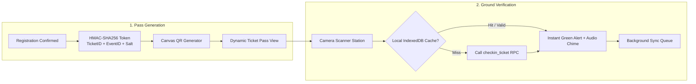

# 03 — Ticketing Platform & Admin Architecture Specification

> **Technical deep dive into the high-concurrency event ticketing engine (`Ticket-Platform`) and the internal operations portal (`clstr.admin`).**

---

## Part 1: Ticket-Platform Architecture & Engine

### 1.1. Overview & Business Criticality
The ticketing platform (housed in [`Ticket-Platform/`](file:///c:/Users/2005g/Downloads/clstr_ecosystem/Ticket-Platform)) serves as the primary top-of-funnel acquisition vehicle for Clstr. By hosting large inter-college fests, technical conferences, cultural summits, and hackathons, the ticketing platform acquires thousands of students in a single day, seamlessly onboarding them into the broader `clstr.in` social network.

Unlike generic ticketing platforms (BookMyShow, Paytm Insider), Ticket-Platform is custom-built for collegiate dynamics:
* Enforces student verification and college identity tagging.
* Handles zero-connectivity offline check-in at remote campus venues.
* Generates instant, verifiable certificates of participation at scale.
* Integrates directly with WhatsApp for pass delivery across low-bandwidth connections.

---

### 1.2. Technology Stack & Framework
* **Framework**: TanStack Start (full-stack SSR framework built on Vite 6 and Nitro engine)
* **Frontend**: React 19 + TypeScript + Tailwind CSS v4.2.1
* **UI Components**: Radix UI primitives + shadcn/ui
* **Database & Storage**: Supabase PostgreSQL 17 + Supabase Storage
* **Concurrency Processing**: Dedicated Web Workers (`src/workers/certificate-batch.worker.ts`)
* **Testing & Quality**: Node test runner (`node --test`) + Playwright E2E test suite

---

### 1.3. Route Architecture & Page Capabilities

```
Ticket-Platform/src/routes/
├── index.tsx                             # Public events discovery feed
├── events.$slug.tsx                      # Rich event detail page, agenda & tiers
├── events.create-enhanced.tsx            # Multi-step event creation wizard
├── ticket.$code.tsx                      # Public cryptographic ticket pass
├── find-ticket.tsx                       # Pass retrieval by phone / email
├── dashboard/
│   ├── events.$id.index.tsx              # Organizer overview & live check-in stats
│   ├── events.$id.checkin.tsx            # Gate scanner interface & manual lookup
│   ├── events.$id.certificates.tsx       # Certificate template designer & batch issuer
│   ├── events.$id.payments.tsx           # UPI / Razorpay payment reconciliation
│   ├── events.$id.promos.tsx             # Discount & college ambassador referral codes
│   ├── events.$id.sponsorships.tsx       # Sponsor lead tracker & pass distribution
│   └── events.$id.waitlist.tsx           # Realtime waitlist prioritization engine
└── onboarding.tsx                        # College student verification bridge
```

---

### 1.4. Dynamic QR Pass & Anti-Fraud Engine



#### Key Technical Safeguards:
1. **Dynamic Rolling QR**: For high-stakes events, the QR code rotates every 60 seconds with an algorithmic timestamp hash, preventing screenshot sharing and gate fraud.
2. **Offline-First Resilience (`src/lib/checkin.ts`)**:
   * Before gates open, organizers sync the event attendee list to local IndexedDB.
   * If campus WiFi drops (common in large auditoriums and festival grounds), the scanner operates entirely offline, storing check-in timestamps in local storage.
   * Once connectivity resumes, an automatic reconciliation worker commits check-ins to Supabase with idempotent conflict resolution.
3. **Multi-Station Sync**: Realtime Supabase channels update total check-in tallies across multiple entrance gates simultaneously.

---

### 1.5. Automated Certificate Generation Subsystem

One of Clstr's highest-retaining features is instant certificate issuance for college fests and hackathons.
* **Architecture**: [`src/lib/certificate-generator.ts`](file:///c:/Users/2005g/Downloads/clstr_ecosystem/Ticket-Platform/src/lib/certificate-generator.ts) & [`src/workers/certificate-batch.worker.ts`](file:///c:/Users/2005g/Downloads/clstr_ecosystem/Ticket-Platform/src/workers/certificate-batch.worker.ts).
* **Batch Execution**:
  * Utilizes HTML5 Canvas rendering in a background Web Worker to prevent UI thread freezing.
  * Ingests CSV or database attendee lists, applies dynamic typography (recipient name, college name, role/rank, QR verification URL), and compiles high-resolution print-ready PDFs.
  * Compresses thousands of certificates into streamed ZIP archives (`certificate-zip.ts`) for organizers, while sending individual download links to students via email and WhatsApp.

---

### 1.6. Notification Infrastructure
* **WhatsApp Delivery (`src/lib/whatsapp-service.ts`)**: Integrates with official WhatsApp Business API to deliver ticket confirmation templates, PDF passes, and gate entry updates directly to students' phones.
* **Email Service (`src/lib/email-service.ts`)**: Transactional email dispatch powered by Resend with SPF/DKIM validation and customized HTML ticket layouts.

---

## Part 2: clstr.admin Portal Specification

### 2.1. Overview & Operational Mandate
The `clstr.admin` application (housed in [`clstr.admin/`](file:///c:/Users/2005g/Downloads/clstr_ecosystem/clstr.admin)) is the mission control center for the founding team and campus operations staff. It enforces trust, monitors student growth across campuses, and oversees cross-college governance.

---

### 2.2. Technology Stack
* **Framework**: React 18.3.1 + TypeScript + Vite SPA
* **Styling**: Tailwind CSS + Radix UI primitives
* **Database & Auth**: Supabase JS with elevated PostgreSQL Service Role permissions
* **Search Indexing**: Algolia InstantSearch (`algoliasearch` 5.59) for millisecond lookups across millions of student records
* **Analytics**: PostHog (`posthog-js`) for user funnels, feature adoption tracking, and session recordings
* **Data Processing**: ExcelJS & PapaParse for bulk college data imports and exports

---

### 2.3. Operational Capabilities

#### 1. College & Domain Governance
* **Domain Alias Engine**: Maps secondary and legacy domains to primary college nodes (e.g., mapping both `@andhrauniversity.edu.in` and `@auvsp.edu.in` to Andhra University).
* **Tier 2 College Registry**: Review and approval queue for colleges lacking official student email domains. Admins can verify college legitimacy, geolocation, and approved email regex patterns.

#### 2. Content Moderation & Abuse Resolution
* Realtime flagging queue for reported campus feed posts, harassment reports, and fraudulent marketplace (EcoCampus) listings.
* Admin controls to issue temporary account mutes, college-wide warning banners, or permanent account terminations with device fingerprint logging.

#### 3. Macro Growth & Network Metrics
* **Density Tracking**: Tracks active student counts per college against total campus strength (penetration percentage).
* **Cross-Campus Health**: Measures CollabHub project formation rates, cross-campus event attendance, and inter-college connection graphs.
* **Cohort Retention**: Daily tracking of D1, D7, and D30 retention curves separated by verification tier (Tier 1 vs. Tier 2).
