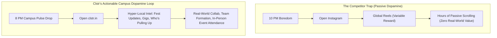

# 06 — Behavioral Economics & Investor Turnaround Playbook

> **The ruthless venture interrogation, behavioral economics doctrine, retention turnaround plan, and defensibility strategy against WhatsApp.**

---

## Part 1: The Ruthless Investor Interrogation (The 20 Lethal Questions)

Any seasoned venture capitalist examining a college student network asks 20 lethal questions. Here is the unvarnished interrogation and Clstr's structural rebuttal:

### 1. Unit Economics & Retention Reality

| # | The Lethal VC Question | The Brutal Risk | Clstr's Strategic Answer |
|---|------------------------|-----------------|--------------------------|
| **1** | **What is your DAU/MAU ratio?** | Sub-0.20 ratios indicate a dead phone directory, not an engaging social network. | Clstr targets a **0.35+ DAU/MAU** by binding daily utility to campus-specific pulse drops (8 PM daily campus drop) and local marketplace listings. |
| **2** | **What is average session length?** | If under 3 min/day, students default back to Instagram. | Clstr does not compete for passive 3-hour doomscrolling; it wins high-intent utility: CollabHub team formations, event passes, and campus marketplace transactions. |
| **3** | **What is your D1/D7/D30 retention?** | Indian campus apps suffer devastating D7 cliffs (>70% churn). | Anchored by offline event ticketing. Once a student buys an event pass or joins a Hackathon Guild, retention spikes because their social identity is tied to real peers. |
| **4** | **How many colleges have >500 users?** | A platform with 500 colleges × 5 users is worthless. Network effects require hyper-local density. | **Density Over Expansion**: Clstr refuses to activate a new college until its 2 Campus Captains secure 200 pre-verified signups. |
| **5** | **What is the verification dropoff?** | Strict `.edu` requirements kill 60% of top-of-funnel signups. | **Tier 2 Non-Edu OTP + Spectator Mode**: Students can browse and buy event tickets instantly, removing the signup friction wall. |
| **6** | **Who actually pays you, and when?** | Students are broke; colleges are bureaucratic; alumni are unengaged. | **Organizers, Sponsors & Employers pay**: Event organizers pay ticketing fees; local brands pay for sponsor activations; recruiters pay for verified student portfolios. |

---

### 2. The Dopamine Deficit & Daily Habit Loops



* **The 8 PM Campus Drop**: Students do not want random posts from stranger universities. At 8:00 PM every evening, Clstr releases the **Campus Pulse**: the day's top discussions, new hackathon teammate requests, and flash tickets for weekend fests.
* **Variable Social Validation**: Every upvote and comment on Clstr comes from a verified classmate, senior, or peer in the same city. One upvote from a respected campus tech lead delivers 10x the psychological dopamine of an anonymous double-tap on Instagram.

---

## Part 2: Applied Behavioral Economics (BJ Fogg & Zeigarnik)

Clstr's engineering roadmap incorporates core behavioral psychology models:

### 1. BJ Fogg Behavior Model ($B = MAP$)
A student performs a behavior ($B$) only when **Motivation ($M$)**, **Ability ($A$)**, and a **Prompt ($P$)** converge simultaneously:
* **Motivation ($M$)**: Campus clout, landing hackathon teammates, discovering who from other colleges is attending the Saturday fest, making money via EcoCampus.
* **Ability ($A$ - Drastic Friction Reduction)**:
  * Eliminating document uploads for Tier 2 onboarding (instant phone OTP).
  * 1-click team application in CollabHub using existing verified profile.
  * 1-tap ticket retrieval via WhatsApp.
* **Prompt ($P$)**: Timely, context-driven alerts (e.g., "3 of your classmates just RSVP'd for the Vizag Student Summit").

### 2. The Zeigarnik Effect & Endowed Progress
* **The Psychology**: Unfinished tasks create cognitive tension that drives completion.
* **Implementation in Clstr**:
  * New signups are never shown a 0% empty profile.
  * Through **Endowed Progress**, selecting their college immediately fills their profile progress bar to **60%**.
  * The remaining 40% (adding skills, linking GitHub) uses curiosity framing ("Add 2 skills to unlock recruiter discovery").

---

## Part 3: Defensibility Against WhatsApp (Why the App Is the Moat)

A frequent investor challenge is: *"Can't students just use a WhatsApp group?"*  
The reality of Indian campus life is that **WhatsApp groups collapse under their own weight once they exceed 200 members**:

```
┌─────────────────────────────────┬──────────────────────────────────┬──────────────────────────────────┐
│ Dimension                       │ Campus WhatsApp / Telegram Groups│ CLSTR Platform (clstr.in)        │
├─────────────────────────────────┼──────────────────────────────────┼──────────────────────────────────┤
│ Member Limit & Scalability      │ Caps out; multiple splinter chats│ Unlimited cross-campus scale     │
│ Verification & Anonymity        │ Zero verification; rampant spam  │ 100% verified student identity   │
│ Harassment & Privacy            │ Phone numbers exposed to everyone│ Zero phone exposure; in-app chat │
│ Content Signal vs Noise         │ Good links buried under 500 "GM"s│ Categorized feeds, top sorting   │
│ Continuity Across Batches       │ Dies when senior admin graduates │ Permanent institutional memory   │
│ Cross-Campus Collaboration      │ Trapped within one college group │ Seamless cross-campus CollabHub  │
│ Sponsor Auditability            │ "Trust me, 500 saw it"           │ Auditable impressions & check-ins│
│ Ticketing & Passes              │ Manual Google Sheets & UPI proof │ Automated QR passes & check-in   │
└─────────────────────────────────┴──────────────────────────────────┴──────────────────────────────────┘
```

---

## Part 4: The 5-Phase Product Turnaround Roadmap

Outlined in [`clstr.network/INDIVIDUAL_PHASE_IMPLEMENTATION_PLAN.md`](file:///c:/Users/2005g/Downloads/clstr_ecosystem/clstr.network/INDIVIDUAL_PHASE_IMPLEMENTATION_PLAN.md):

```
┌────────────────────────────────────────────────────────────────────────────────────────┐
│                        5-PHASE BEHAVIORAL EXECUTION ROADMAP                            │
├─────────┬───────────────────────────────┬──────────────────────────────────────────────┤
│ Phase   │ Name                          │ Primary Behavioral & Engineering Deliverables│
├─────────┼───────────────────────────────┼──────────────────────────────────────────────┤
│ Phase 0 │ Foundation & Security Debt    │ • Rotate API keys, eliminate auth bypasses   │
│         │ (Immediate Days 1–2)          │ • Deprecate hardcoded passcodes in ClubAuth  │
│         │                               │ • Hardened RLS policies on college feeds     │
├─────────┼───────────────────────────────┼──────────────────────────────────────────────┤
│ Phase 1 │ Foot-in-the-Door & Zeigarnik  │ • Rebrand Spectator Mode to "Guest Explorer" │
│         │ (Week 1, Days 3–7)            │ • 60% endowed profile completion meter       │
│         │                               │ • Loewenstein curiosity blur for new members │
├─────────┼───────────────────────────────┼──────────────────────────────────────────────┤
│ Phase 2 │ Event Scarcity & Campus Ledger│ • "Who's Pulling Up" social facepile on fests│
│         │ (Week 2)                      │ • Dynamic ticket scarcity counters (5 left)  │
│         │                               │ • Verified student attendance badge issuance │
├─────────┼───────────────────────────────┼──────────────────────────────────────────────┤
│ Phase 3 │ Campus Pulse (Pilot Launch)   │ • 8:00 PM variable-interval daily intel drop │
│         │ (Week 3)                      │ • 1-tap anonymous campus alias composer      │
│         │                               │ • Wilson score engagement ranking for posts  │
├─────────┼───────────────────────────────┼──────────────────────────────────────────────┤
│ Phase 4 │ Paid Micro-Gigs & Clout Decay │ • Instant ₹ bounties for campus tasks        │
│         │ (Week 4)                      │ • Recruiter radar spotlight for top builders │
│         │                               │ • Status decay: inactive members lose clout  │
└─────────┴───────────────────────────────┴──────────────────────────────────────────────┘
```

---

## Part 5: Sustainable Unit Economics & Monetization

Clstr operates a multi-vertical monetization model that does not depend on charging cash-strapped students for basic social networking:

1. **Event Ticketing Take Rate (B2C / B2B)**:
   * 5% platform fee on paid college fest tickets, hackathon registrations, and cultural concerts processed through `Ticket-Platform`.
2. **Brand & Sponsor Activations (B2B)**:
   * City-wide sponsor packages (₹25,000 to ₹1,50,000 per brand) for consumer brands (F&B, laptops, fintech, apparel) seeking verified, on-ground collegiate distribution.
3. **Verified Campus Recruitment (B2B)**:
   * Startups and IT service companies pay for access to pre-vetted, project-backed student portfolios and hackathon leaderboards, eliminating recruitment agency fees.
4. **Campus Marketplace Micro-Fees (P2P)**:
   * Optional escrow protections for high-ticket campus transactions (laptops, electronic kits, cycles).
