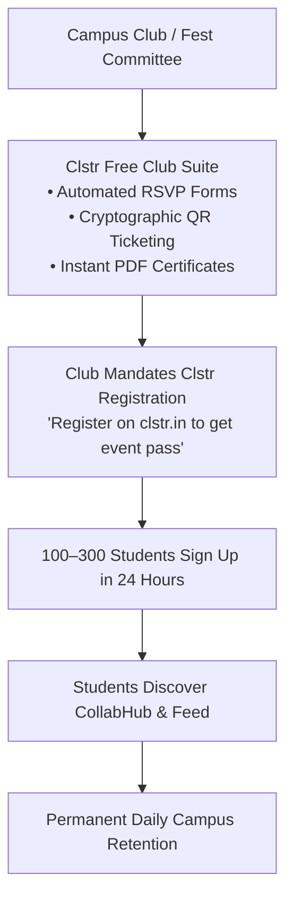

# 08 — Marketing, Growth & Campus Student Acquisition Playbook

> **The definitive campus marketing, brand positioning, growth loops, and student acquisition manual for Clstr — synthesized from `marketingskills/` and production campaign intelligence.**

---

## 1. Executive Marketing Doctrine & The Anti-Instagram Positioning

### 1.1. The Positioning Core
Clstr does not compete with Instagram for mindless 3-hour doomscrolling. Instagram is a global entertainment slot machine. Trying to build a "better Reels feed" or "college Instagram" is suicidal.

Clstr is positioned with absolute clarity:
> **“Instagram is for entertainment. Clstr is for college opportunities and finding your team.”**  
> **“Your college gets you a degree. Clstr gets you a city.”**

```
┌─────────────────────────────────┬─────────────────────────────────┐
│       INSTAGRAM / REELS         │          CLSTR (clstr.in)       │
├─────────────────────────────────┼─────────────────────────────────┤
│ • Passive scrolling & consumption│ • Active collaboration & building│
│ • Global strangers & celebrities│ • Verified classmates & city peers│
│ • Superficial vanity metrics    │ • Hackathon teams, gigs & jobs  │
│ • Wastes 2 hours before sleep   │ • Unlocks your next internship  │
│ • Anonymity, bots & harassment  │ • 100% verified campus identity │
└─────────────────────────────────┴─────────────────────────────────┘
```

When an ambassador or student is confronted with: *"Why do I need this when I have Instagram?"*, the response is hard-coded:
> *“Instagram connects you to influencers you’ll never meet. Clstr connects you to the developer in the building next door who can help you win the ₹50,000 hackathon this Saturday.”*

---

## 2. The 6-Week Campus Launch Cycle

Housed in [`marketingskills/skills/clstr-campus-growth/`](file:///c:/Users/2005g/Downloads/clstr_ecosystem/marketingskills/skills/clstr-campus-growth). Every college activation adheres to a strict, non-negotiable 6-week operational rhythm:

```
┌────────────────────────────────────────────────────────────────────────────────────────┐
│                              THE 6-WEEK CAMPUS LAUNCH CYCLE                            │
├──────────────┬───────────────────────────────┬─────────────────────────────────────────┤
│ Timeline     │ Phase Name                    │ Core Deliverables & Milestones          │
├──────────────┼───────────────────────────────┼─────────────────────────────────────────┤
│ Weeks 1–2    │ Seeding & Ground Recon        │ • Recruit 1 Campus Captain + 4 Ambassadors│
│              │                               │ • Onboard 5–8 active campus clubs       │
│              │                               │ • Seed 25 verified early-adopter profiles│
│              │                               │ • Pre-populate campus feed with 15 posts│
│              │                               │ • 3 informal canteen/hostel demo sessions│
├──────────────┼───────────────────────────────┼─────────────────────────────────────────┤
│ Weeks 3–4    │ Controlled Campus Launch      │ • Ambassador 2-minute classroom pitches │
│              │                               │ • First campus event hosted on Clstr    │
│              │                               │ • Campus poster drop across xerox/cafes │
│              │                               │ • 3-friend referral mechanic activated  │
│              │                               │ • Target: 5+ active posts/day on feed   │
├──────────────┼───────────────────────────────┼─────────────────────────────────────────┤
│ Weeks 5–6    │ Activation & Habit Lock       │ • CollabHub project hackathon pairings  │
│              │                               │ • Senior-to-junior mentorship activated │
│              │                               │ • 8:00 PM daily campus pulse drops      │
│              │                               │ • Audit against Campus Activation Gate  │
└──────────────┴───────────────────────────────┴─────────────────────────────────────────┘
```

---

## 3. The Campus Activation Threshold (Health Gate)

A college campus is **never considered "Launched"** until it crosses the 5-point Activation Floor:

| Metric | Minimum Threshold | Why It's Critical |
| :--- | :---: | :--- |
| **Registered Verified Students** | **50+ students** | Minimum critical mass to prevent an empty feed feeling. |
| **Weekly Active Users (WAU)** | **≥ 40%** | Proves the product is retained, not just installed once. |
| **Weekly Content Velocity** | **≥ 12 posts / week** | Guarantees fresh discussions whenever a student opens the app. |
| **Social Graph Density** | **≥ 60% with connections** | Users with ≥3 connections have 4.2x higher D30 retention. |
| **Active Senior / Alumni Node** | **≥ 2 mentors** | Unlocks the vertical mentorship loop (seniors guiding juniors). |

If a campus drops below these numbers at Week 6, expansion to the next college is paused, and an **Ambassador Surge Week** is triggered.

---

## 4. The Club-First Adoption Flywheel

Student clubs (CSI, IEEE, GDG, E-Cell, Rotaract, Cultural Committees) are the lifeblood of campus distribution. Instead of begging clubs to promote Clstr, Clstr provides clubs with superior operational software:



1. **Free Ticketing & Check-In**: Clubs usually manage fests through messy Google Sheets and manual UPI verification. Clstr offers them [`Ticket-Platform`](file:///c:/Users/2005g/Downloads/clstr_ecosystem/Ticket-Platform) for free.
2. **Automated Certificates**: Clstr generates and emails verified PDF certificates to all checked-in attendees in 1 click, saving club organizers 20 hours of manual Photoshop exports.
3. **The Catch**: To get the pass and certificate, attendees must create a verified Clstr profile. One fest onboards 300 students in a single afternoon.

---

## 5. Visual Marketing & The 40-Poster Campaign Doctrine

Housed in [`marketingskills/docs/clstr-content/poster-concepts.md`](file:///c:/Users/2005g/Downloads/clstr_ecosystem/marketingskills/docs/clstr-content/poster-concepts.md).  
Clstr rejects generic corporate tech design. Campus posters must stop students in their tracks near college canteens, bus stops, hostel gates, and xerox shops:

### Design Language (ATD Standard):
* **Typography**: Space Grotesk Bold headers with high-contrast monochrome backgrounds.
* **Palette**: Deep Void Black (`#09090b`), Electric Yellow / Neon Lime (`#ccff00`) accents, Clean Chalk White.
* **Tone**: Provocative, direct, authentic, zero-fluff, hyper-local.

### Flagship Poster Copy Concepts:
1. **The Isolation Breaker (Near Hostels)**:
   > *"You live 500 meters from a developer who could build your startup idea. Too bad you don’t know their name. Find them on Clstr."*
2. **The Degree vs City Reality (Main Gate)**:
   > *"Your college gets you a degree. Clstr gets you a city. Visakhapatnam is your campus now."*
3. **The Xerox Shop Reality (Near Stationery Stores)**:
   > *"Stop begging seniors for 3rd-semester notes on WhatsApp groups that went dead in 2023. Download verified campus study kits on Clstr."*
4. **The Hackathon Callout (Lab Buildings)**:
   > *"Need a UI designer before Friday midnight? 14 verified designers from GVP and AU are waiting on CollabHub."*

---

## 6. Multi-Channel Content Matrix & 30-Day Calendar

```
┌───────────┬───────────────────┬────────────────────────────────────────────────────────┐
│ Channel   │ Cadence           │ Content Pillars & Execution Format                     │
├───────────┼───────────────────┼────────────────────────────────────────────────────────┤
│ Instagram │ 4x / week (Reels) │ • "Day in the life of a Vizag student developer"       │
│           │                   │ • Canteen debates: "Best biryani near GITAM vs Raghu"  │
│           │                   │ • "How 3 students from different colleges won ₹1 Lakh" │
├───────────┼───────────────────┼────────────────────────────────────────────────────────┤
│ LinkedIn  │ 3x / week         │ • Deep dives into Tier-2/3 student hiring trends       │
│           │                   │ • Highlighting top open-source projects on CollabHub   │
│           │                   │ • Student builder spotlights and placement case studies│
├───────────┼───────────────────┼────────────────────────────────────────────────────────┤
│ WhatsApp  │ Daily 8:00 PM     │ • The 8:00 PM Campus Pulse Broadcast:                  │
│ Broadcast │                   │   - 1 hot campus debate                                │
│           │                   │   - 2 urgent teammate requests                         │
│           │                   │   - 1 weekend fest ticket drop                         │
├───────────┼───────────────────┼────────────────────────────────────────────────────────┤
│ Twitter/X │ Daily             │ • Tech commentary, hackathon results, meme commentary  │
│           │                   │   on engineering college life in Andhra Pradesh        │
└───────────┴───────────────────┴────────────────────────────────────────────────────────┘
```

---

## 7. Psychological Growth Loops & Viral Mechanics

1. **The "Who's Pulling Up" Event Loop**:
   When a student RSVPs for a fest on `Ticket-Platform`, the app generates an aesthetic Instagram Story card:  
   *“I’m pulling up to the Vizag Student Summit. Who’s coming with me? [clstr.in/e/summit]”*  
   Connected friends see the social proof and click to claim their passes.
2. **The Endowed Progress Onboarding Loop**:
   New signups start with **60% profile completion** the moment they verify their college. A subtle Loewenstein curiosity prompt blurs out incoming project invitations until they add their primary skill, converting casual visitors into activated builders.
3. **The Ripple Referral Loop**:
   Unlocking premium features (e.g., unlimited AI mock interviews or VIP fest passes) requires inviting 3 verified college peers via a personal referral code.
